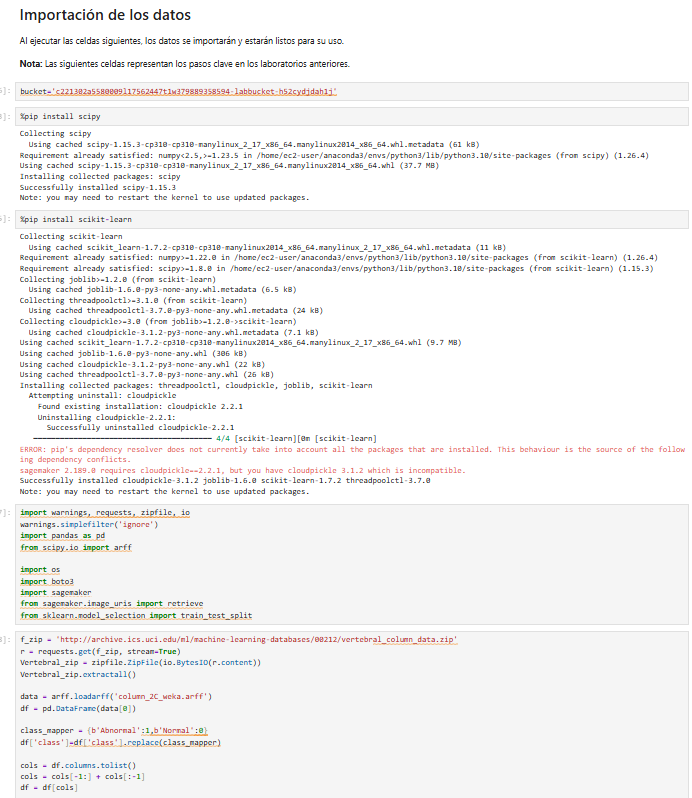
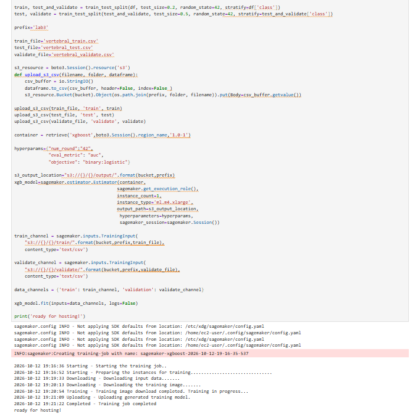
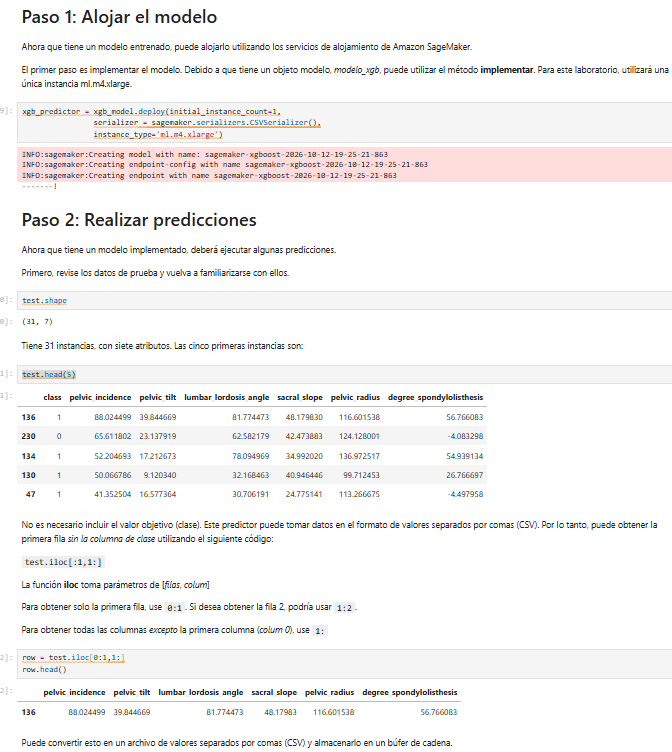
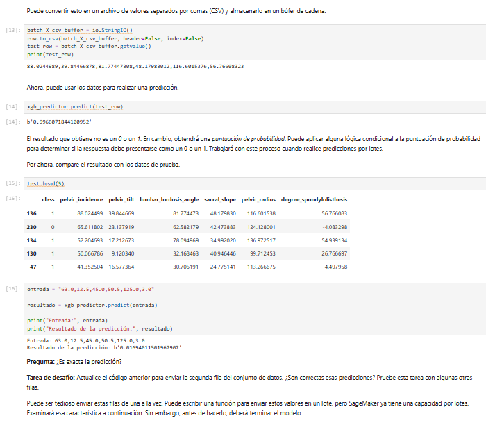
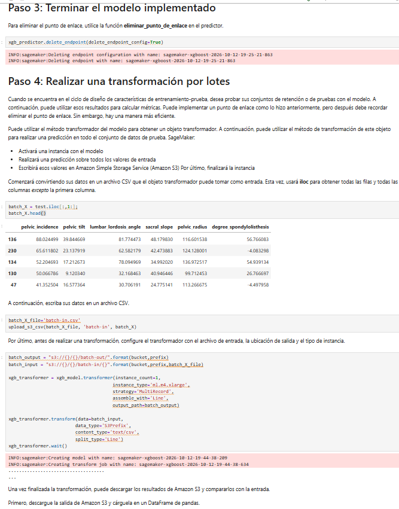
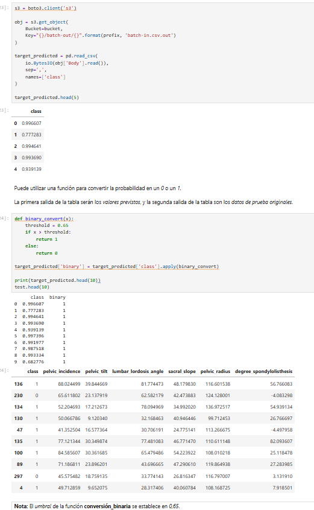

# Laboratorio 3.5: Implementación y predicción con Amazon SageMaker

## 1. Introducción

En este laboratorio se continuó trabajando con el conjunto de datos de la columna vertebral utilizado en el laboratorio anterior. El objetivo fue implementar un modelo de aprendizaje automático con Amazon SageMaker, realizar predicciones individuales y procesar varios datos mediante una transformación por lotes.

Durante el desarrollo se utilizaron Amazon SageMaker y Amazon S3 para entrenar el modelo, generar predicciones y almacenar los resultados.

## 2. Objetivo

Comprender cómo implementar un modelo de clasificación en Amazon SageMaker, realizar predicciones con datos nuevos y utilizar la transformación por lotes para procesar un conjunto de datos.

## 3. Desarrollo del laboratorio

### 3.1. Importación y configuración de los datos

Se instalaron las bibliotecas necesarias para ejecutar el código y se importó el conjunto de datos de la columna vertebral. Después, se organizaron los registros y se prepararon los conjuntos de entrenamiento, prueba y validación. También se cargaron los archivos en Amazon S3 para utilizarlos durante el entrenamiento.

**¿Qué se logró?**

Se prepararon los datos y se dejaron disponibles para trabajar con el algoritmo XGBoost.

**Evidencia 1. Importación y configuración de los datos**



### 3.2. Entrenamiento del modelo XGBoost

Se configuró el algoritmo XGBoost y se ejecutó el entrenamiento en Amazon SageMaker. El proceso finalizó correctamente y mostró el mensaje `ready for hosting!`, indicando que el modelo estaba listo para ser implementado.

**¿Qué se logró?**

Se obtuvo un modelo entrenado que posteriormente se utilizó para realizar predicciones.

**Evidencia 2. Entrenamiento del modelo XGBoost**



### 3.3. Implementación del modelo en un endpoint

Después de completar el entrenamiento, se implementó el modelo mediante un endpoint de SageMaker, utilizando una instancia `ml.m4.xlarge`. Esto permitió enviar datos al modelo y recibir los resultados de las predicciones.

**¿Qué se logró?**

Se habilitó el modelo para realizar predicciones individuales mediante el endpoint `xgb_predictor`.

**Evidencia 3. Implementación del modelo**



### 3.4. Validación del modelo con los datos solicitados por el profesor

Para comprobar el funcionamiento del modelo, se realizó la prueba específica solicitada por el profesor, utilizando el endpoint `xgb_predictor` y los siguientes datos de entrada:

**Entrada solicitada:**

`63.0,12.5,45.0,50.5,125.0,3.0`

Se utilizó el siguiente código:

```python
entrada = "63.0,12.5,45.0,50.5,125.0,3.0"

resultado = xgb_predictor.predict(entrada)

print("Entrada:", entrada)
print("Resultado de la predicción:", resultado)
```

**Resultado obtenido:**

`0.01694011501967907`

**Interpretación del resultado**

El modelo generó una puntuación de aproximadamente 0,01694, equivalente al 1,69 %. Esta puntuación representa la estimación del modelo y no una clasificación directa.

Si se utiliza un umbral de 0,5 para convertir el resultado en una clase binaria, la predicción corresponde a la clase **0 (Normal)**, de acuerdo con la codificación utilizada en el laboratorio.

Con esta prueba se verificó que el endpoint recibió los seis valores indicados por el profesor y generó una respuesta. El resultado corresponde a una estimación del modelo y no constituye un diagnóstico médico.

**Evidencia 4. Validación individual con los datos del profesor**



### 3.5. Eliminación del endpoint

Después de realizar las predicciones individuales, se eliminó el endpoint y su configuración mediante el siguiente código:

```python
xgb_predictor.delete_endpoint(delete_endpoint_config=True)
```

La ejecución mostró los mensajes correspondientes a la eliminación del endpoint y de su configuración.

**¿Qué se logró?**

Se liberó el recurso de alojamiento utilizado para las predicciones individuales antes de continuar con la transformación por lotes.

**Evidencia 5. Eliminación del endpoint y transformación por lotes**



### 3.6. Transformación por lotes

Se seleccionaron las características de entrada del conjunto de prueba y se guardaron en un archivo CSV llamado `batch-in.csv`. Después, se cargó el archivo en Amazon S3 y se configuró un trabajo de transformación por lotes en SageMaker.

El trabajo procesó los registros y guardó las predicciones en una ubicación de salida de Amazon S3. Según la consola de AWS, la transformación finalizó correctamente.

**¿Qué se logró?**

Se procesaron varios registros en una sola ejecución, sin tener que enviar cada uno individualmente al endpoint.

### 3.7. Revisión de los resultados y clasificación binaria

Una vez finalizada la transformación, se recuperaron los resultados desde Amazon S3 y se cargaron en un DataFrame de pandas para revisarlos.

El modelo generó puntuaciones de probabilidad. Posteriormente, se aplicó una función con un umbral de 0,65 para convertirlas en clases binarias: 1 cuando la puntuación supera el umbral y 0 cuando es igual o inferior.

Los resultados se compararon con los registros originales del conjunto de prueba para observar las predicciones generadas.

**¿Qué se logró?**

Se organizaron las predicciones, se convirtieron las probabilidades en clases binarias y se facilitó la revisión de los resultados.

**Evidencia 6. Resultados de la transformación por lotes**



## 4. Conclusiones

En este laboratorio se aprendió a implementar un modelo de aprendizaje automático en Amazon SageMaker y a utilizar un endpoint para realizar predicciones individuales. También se llevó a cabo la prueba solicitada por el profesor con los datos específicos y se interpretó la puntuación obtenida.

Finalmente, se realizó una transformación por lotes para procesar varios registros, almacenar los resultados en Amazon S3 y convertir las probabilidades en clases binarias. La actividad permitió comprender mejor cómo se utilizan los modelos de aprendizaje automático en la nube y por qué es importante revisar e interpretar sus resultados.
## 5. Identificación y organización de las evidencias

**Estudiante:** Linda Ortiz

**Correo institucional:** lortiz73@unisalle.edu.co

**Actividad:** Laboratorios 3.4 y 3.5 de Amazon SageMaker

El notebook del laboratorio 3.5 y las capturas de pantalla se encuentran organizados en esta carpeta del repositorio. Las evidencias documentan la configuración de los datos, el entrenamiento del modelo, la validación individual y la transformación por lotes.
## 6. Consideraciones sobre los resultados

Las puntuaciones generadas por el modelo son estimaciones y deben interpretarse teniendo en cuenta el umbral de clasificación utilizado. En la transformación por lotes se aplicó un umbral de 0,65 para convertir las puntuaciones en clases binarias. Por esta razón, una misma puntuación puede clasificarse de forma diferente si se utiliza otro umbral. La comparación con las etiquetas reales permite identificar aciertos y errores de clasificación.
